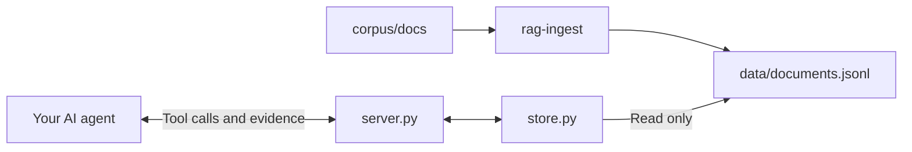

# RAG-Symposium

A small search tool that an AI agent on your laptop can use to answer questions
from documents and cite the page. It comes with 62 official U.S. AI rules and
guidance documents (1,847 pages, in [corpus/](corpus/README.md)), three search
modes to compare, a way to score them, and a converter that makes your own AI
sessions searchable the same way. Everything runs locally; no account or API
key is needed for the search itself.

## Start here

Send this to an AI agent that can run commands on your laptop:

```text
Set up https://github.com/Cambrian-Systems/RAG-Symposium on this computer by following the AGENTS.md file in it. Tell me when it's done and what to do next.
```

If you already have this folder, open it in your agent and send
`Follow AGENTS.md in this folder to set this up.`

- [Setup](#setup): install the project and connect the search tools.
- [Workshop](#workshop): prompts and exercises to follow together.
- [Reference](#reference): commands, search modes, and project files.
- [Troubleshooting](#troubleshooting): common problems and fixes.

Use a local agent such as Codex, Claude Code, Cursor, Copilot in VS Code,
Gemini CLI, or OpenCode. A chatbot that only runs in a browser tab cannot
perform this setup.

**No agent yet?** Install [OpenCode](https://opencode.ai/desktop) (installers
are also on the USB sticks). Type `/connect`, choose **OpenCode**, and enter
the API key provided at the workshop. Then type `/models` and pick
**GLM-5.3-Flash**. If you have ChatGPT Plus or Pro, or GitHub Copilot, you can
choose **OpenAI** or **GitHub Copilot** in `/connect` instead.

## Setup

Your agent does the setup by following [AGENTS.md](AGENTS.md): it gets the
folder, installs `uv` if it is missing, installs the project, loads the
documents, and connects the search tools to itself.

By hand, with [uv](https://docs.astral.sh/uv/) installed, in this folder:

```bash
uv sync --locked
uv run rag-ingest
uv run rag-check
```

`rag-check` should print four lines that start with `PASS`. Then connect your
agent to the search server; [mcp.example.json](mcp.example.json) shows the
settings, and OpenCode reads [opencode.jsonc](opencode.jsonc) by itself.

## Workshop

After setup, copy each prompt into your agent.

### Checkpoint 1: is your data loaded?

```text
Did setup finish? How many records are loaded?
```

You should see 1,847 records.

Fallback: `uv run rag-check`

### Checkpoint 2: can your agent see the tools?

Start a new session, then ask:

```text
What tools do you have, and is the data loaded?
```

It should call `data_status` and report 1,847 records in bm25 mode. Look for
three tools: `data_status`, `search_documents` and `get_document`. Your agent
may show them with a prefix such as `rag_`. You may also see the same three for
`sessions`, with 0 records: those are for part two.

If the tools are missing, your agent could not start the search server,
usually because it cannot find uv. Paste this, then start a new session:

```text
Find the full path of the uv program on this computer and put that full path in place of "uv" in the rag server settings (opencode.jsonc if this is OpenCode).
```

### Checkpoint 3: does the cited page actually say it?

Ask a question about U.S. AI rules: your own, or one of these, which the
documents can answer.

```text
Can NIH reviewers use ChatGPT to help write their critiques?
```

```text
Do I have to tell NSF if I used AI to write my grant proposal?
```

```text
Can federal education grant money pay for a chatbot that advises students?
```

```text
Should there be a law against making an AI clone of my voice without permission?
```

```text
How much did generative AI use grow at federal agencies between 2023 and 2024?
```

```text
How many grant applications can one researcher submit to NIH in a year?
```

Then ask:

```text
Show me the exact passage you cited, and which document and page it's from.
```

Open that page yourself. Each document is a text file in `corpus/docs/`, named
by its ID, with page markers inside. Does the page say that?

Fallback: `uv run rag-search "your question"` shows exactly what search hands
the agent.

### Search your own AI sessions (15 minutes)

```text
Turn my AI sessions on this laptop into a searchable collection.
```

Your agent runs `uv run rag-sessions`. It finds the sessions your AI agents
saved on this laptop (Claude Code, Codex, OpenCode, Gemini CLI), replaces
anything that looks like a password or key with `[REDACTED]`, writes one
short summary per session, keeps each full transcript beside it in
`sessions/transcripts/`, and loads the summaries into the `sessions` search
tools. Nothing leaves your laptop. If you use one of those agents, you have at least today's
setup session. If it finds none (Cursor and Copilot keep their history
somewhere else), pair with a neighbour or load a chatbot export (below).
Then start a new session, so the `sessions` tools see the new data. Then ask something
about your own work history: a decision you made, a prompt you wish you'd kept,
something from last month.

A summary finds the session. For the details, ask your agent to open the full
transcript for that session.

To see why the summaries are what gets searched, try the raw layer and ask the
same question again:

```text
Rebuild my sessions in raw mode, then ask the same question again.
```

Web chatbots (ChatGPT, Claude, Gemini) keep your history on their servers.
Request an export (ChatGPT: Settings › Data controls › Export data; Claude:
Settings › Privacy › Export data; Gemini: Google Takeout); it arrives by email.
Then: `Load my chatbot export from <path to the zip>.`

Redaction catches the obvious patterns, not everything. Read a few documents
in `sessions/docs/` before you share anything.

Fallback: `uv run rag-sessions`, then
`uv run rag-search "what went wrong during setup?" --data data/sessions.jsonl --mode bm25`.
`uv run rag-sessions --mode raw` searches every message and tool output instead
of the summaries. `uv run rag-sessions --export path/to/export.zip` loads a
chatbot export.

### Your own documents (if there is time)

```text
Add this document to the collection.
```

Give it a file, or paste the text. Then ask a question only that document can
answer.

Before you load anything sensitive: the documents and the search stay on your
laptop, but your question and every passage search returns are sent to whoever
runs your model.

Fallback: `uv run rag-add path/to/your-file.pdf` (PDF, Word, HTML or text),
then `uv run rag-ingest`. See [Using your own documents](#using-your-own-documents).

### Habits that save time

- **Start a new session** after any change to the search server's settings or
  to `server.py`. The search server only restarts with a new session. Don't
  ask the agent to reconnect.
- **Web search.** This folder switches OpenCode's web tools off. Other agents
  probably have web search on, so check whether each answer came from the
  documents or from the web.

## Reference

## What's in this folder

| Path | What it is |
| --- | --- |
| [AGENTS.md](AGENTS.md) | Instructions automatically read by compatible AI agents |
| [opencode.jsonc](opencode.jsonc), [mcp.example.json](mcp.example.json) | How an agent connects to the search server: OpenCode's settings, and an example for other agents |
| [corpus/](corpus/README.md) | The 62 documents, one text file each in `corpus/docs/` |
| [evals/starter.jsonl](evals/starter.jsonl) | Test questions with the documents (and pages) that answer them |
| [models/](models/potion-base-8M) | The small embedding model hybrid search uses, so nothing is downloaded |
| `data/` | Where the search exports are written on your laptop; never committed |
| [src/rag_symposium/server.py](src/rag_symposium/server.py) | The MCP server: the three tools an agent sees, and their descriptions |
| [src/rag_symposium/store.py](src/rag_symposium/store.py) | The three search modes, citations and reading a record |
| [src/rag_symposium/ingest.py](src/rag_symposium/ingest.py) | `rag-ingest`: chunks the documents into records |
| [src/rag_symposium/embeddings.py](src/rag_symposium/embeddings.py) | Loads the embedding model for hybrid search |
| [src/rag_symposium/search.py](src/rag_symposium/search.py) | `rag-search`: one question's results, from the command line |
| [src/rag_symposium/evaluate.py](src/rag_symposium/evaluate.py) | `rag-eval`: scores the search modes against the test questions |
| [src/rag_symposium/check.py](src/rag_symposium/check.py) | `rag-check`: PASS/FAIL for the export, the model and the searches |
| [src/rag_symposium/convert.py](src/rag_symposium/convert.py) | `rag-add`: your own PDF, Word, HTML and text files as corpus documents |
| [src/rag_symposium/sessions.py](src/rag_symposium/sessions.py) | `rag-sessions`: your own AI sessions as searchable documents |
| `tests/` | Unit tests and a check that starts the real server: `uv run python -m unittest discover -s tests` and `uv run python tests/mcp_smoke.py` |

## How the pieces work together



- **Ingestion** splits the documents into records and keeps each one's source,
  pages, dates and status. It runs once, not on each question.
- **The server** offers three read-only tools over MCP. It does not generate
  answers.
- **Your agent** decides when to call the tools and writes the answer from what
  they return. Its model and account are set in the agent, not here.

| Tool | Inputs | What it returns |
| --- | --- | --- |
| `data_status` | None | The data file, record count and search mode |
| `search_documents` | `query`; optional `limit` (default 5, maximum 10) | Excerpts up to 600 characters each, with record ID, source, `document_status` and metadata |
| `get_document` | `document_id`; optional `offset` and `max_chars` | More of one record's text (4,000 characters by default); follow `next_offset` to keep reading |

`document_status` sums up a document's standing in one line, such as `revoked;
published 2023-10-30; replaced by EO-14148` for Executive Order 14110. The
server asks the agent to state it when citing and to prefer documents in force.

A citation identifies a record; it does not prove the claim. Tool descriptions
guide the agent but do not guarantee it searches or reads carefully. Open the
cited page and check.

## Ingestion

`rag-ingest` reads every document in `corpus/docs/`, splits it into records
and publishes `data/documents.jsonl` in one step. A running server sees the new
export on its next tool call.

| Mode | One record per | Record ID | Records from the workshop corpus |
| --- | --- | --- | --- |
| `page` (default) | PDF page, or numbered ~3,000-character section of a web page | `OMB-M-24-10-p3` | 1,847 |
| `window` | ~1,500-character window, 200 characters shared with the next | `OMB-M-24-10-w7` | 4,214 |
| `document` | Document | `OMB-M-24-10` | 62 |

```sh
uv run rag-ingest --mode window --size 1000 --overlap 150
uv run rag-ingest --mode document --output data/whole-docs.jsonl
```

Every record's metadata carries `document_id`, `pages`, `chunk_index`,
`aliases`, `issuer`, `published`, `revised`, `status`, `status_note`,
`replaces`, `replaced_by`, `topics` and `credit`, copied from its document's
header (see [corpus/README.md](corpus/README.md)). So an answer can cite a page,
name who issued the document, and say that it was revoked and what replaced it.
Blank pages are skipped. Chunking changes what search can return: a page can
split a table from its heading, a window can split a sentence, and a whole
document buries one paragraph in dozens of pages.

Each record is one JSON line with `id`, `title`, `text`, `source` and
`metadata`. Ingestion validates every record before publishing, so a bad
document fails here and the previous export stays in place.

## Search modes

All three modes search the same records and return the same citations. The server
picks one when it starts (`--search bm25` in its settings); after changing it,
start a new session.

| Mode | How it ranks | What fools it |
| --- | --- | --- |
| `keyword` | Counts distinct query words in the title and text. Every word counts the same, and ID breaks ties. It deliberately does not recognize document IDs | Common words (*the, for, in*) count as much as *deepfake*; pages of a report that cites `M-24-10` outrank the memo itself |
| `bm25` | Rare words count more than common ones, long records don't win by size, title matches get a boost, and records whose document ID or alias is in the query come first. Simple plurals match (*deepfakes* finds *deepfake*) | Different words for the same thing (*AI* vs *SI* or *Super Intelligence*), tables, and anything that needs meaning rather than matching words |
| `hybrid` | BM25 and embedding similarity each rank the records; reciprocal rank fusion combines the two lists. Document IDs and aliases still come first | Tables, old documents that match well (a revoked order reads like a current one), and anything the embedding model wasn't trained to understand |

In `bm25` and `hybrid`, an ID or alias matches however it is written: `M-24-10`,
`m 24 10`, `OMB M-24-10`, `EO 14110` and `Executive Order 14110` all put that
document's own pages first. Case, spaces and dashes are ignored, but the match
must be whole words, so `EO 141105` is not `EO 14110`. Each document's aliases
are listed in its header.

Words changed in the newest documents. Executive Order 14434 (September 29,
2026) tells agencies to write "Super Intelligence" or "SI" instead of
"Artificial Intelligence" or "AI", so the Department of Education's November
2026 proposal (`ED-FR-2026-22615`) talks about *SI literacy* while its April
2026 final rule (`ED-FR-2026-07087`) defines *AI literacy*. A word search for
one term can miss documents that use only the other.

Hybrid mode embeds every record with
[potion-base-8M](https://huggingface.co/minishlab/potion-base-8M) (MIT license),
a ~30 MB static embedding model that runs on a laptop CPU: the whole corpus
embeds in about a second when the server first searches, and again whenever the
export changes. A copy of the model ships in [models/](models/potion-base-8M), so
hybrid search needs no download; `--embed-model` can name another local folder
or a Hugging Face model to compare. Each
hybrid result's `ranks` shows where BM25 and the embeddings placed it, so you can
see which method found it.

`bm25` and `hybrid` results also carry a `score`, an `id_match` flag and each result's
`missing_terms`. The response lists `missing_terms` (meaningful query words no
returned result contains) and `unknown_terms` (words in no record at all), and
its notice says so. That warning only catches missing *words*. "How many
students used AI tools in 2026?" gets no warning, because the 2026 Department of
Education grant priorities contain every word, yet they are not a count of
students. Search
can't tell you the answer isn't there; the agent has to read the text and say so.
It also has to read `document_status`: "What must agencies do under OMB M-24-10
by December 2026?" returns the memo's own pages, and every one is marked
`rescinded`.

To see exactly what the agent would receive for one question, without an agent:

```sh
uv run rag-search "What is the Department of Education's current definition of AI literacy?"
uv run rag-search "M-24-10" --mode keyword --mode bm25
```

The first shows the in-force April 2026 rule and the November 2026 draft side by
side; change *AI* to *SI* and `bm25` returns only the draft. The second shows
keyword search ranking pages of a CRS report that cites the memo, while `bm25`
puts the memo's own pages first:

```text
keyword
  1. CRS-R48555-p11      2025-06-04 unknown    Regulating Artificial Intelligence: U.S. and Internation
  ...

bm25
  1. OMB-M-24-10-p24 2024-03-28 rescinded Advancing Governance, Innovation, and Risk Management fo
  2. OMB-M-24-10-p1  2024-03-28 rescinded Advancing Governance, Innovation, and Risk Management fo
  ...
```

## Measure retrieval with rag-eval

```sh
uv run rag-eval
uv run rag-eval --mode bm25 --show all
uv run rag-eval --questions my-questions.jsonl --data data/whole-docs.jsonl
```

`rag-eval` runs each question in `evals/starter.jsonl` through every search mode
against the current export and prints a table. No model is involved:

| Number | Meaning |
| --- | --- |
| document hit@1 | Share of questions where the first result came from a right document |
| document hit@5 | Share where a right one was anywhere in the top 5 (change with `-k`) |
| MRR | Average of 1/rank: 1 for first place, 0.5 for second, 0 for a miss |
| page hit@1, page hit@5 | The same, counting only questions that name pages, and the result must also cover one of those pages |
| warned: no answer | For questions with no answer in the data, how many got a `missing_terms` warning |
| warned: has answer | False alarms: questions the data does answer that got a warning anyway |

Document-level scores ask whether search found the right document; page-level
scores ask whether it found the right page of it. The right memo on the wrong
page is a document hit and a page miss.

With the starter questions and the default page-mode export:

| Mode | document hit@1 | document hit@5 | MRR | page hit@1 | page hit@5 | warned: no answer | warned: has answer |
| --- | --- | --- | --- | --- | --- | --- | --- |
| `keyword` | 14% | 50% | 0.28 | 5% | 27% | 0 of 4 | 0 of 22 |
| `bm25` | 55% | 77% | 0.62 | 32% | 50% | 2 of 4 | 12 of 22 |
| `hybrid` | 59% | 77% | 0.65 | 41% | 50% | 4 of 4 | 15 of 22 |

Each question line names the documents that answer it. For example:

```json
{"id": "x01", "category": "fact", "question": "How does the Department of Education define AI literacy?", "expect": ["ED-FR-2026-07087"], "pages": [6]}
```

`pages` is optional; when present, the question also counts toward the page
scores. `"all": true` requires every listed document in the top k, for questions
that need two sources. An empty `expect` list means the data has no answer.

The score measures whether the evidence reached the agent, not whether the
agent's answer was right. Agents also rewrite questions into their own search
queries, so a question that fails here can still succeed in a chat, and the
other way round. Compare modes and chunking (`rag-ingest --mode ...`, then
`rag-eval --data ...`) on the same questions; a change that fixes one question
can break another.

## Using your own documents

`rag-add` converts your files into the same format as the workshop documents.
It reads PDF, Word (`.docx`), saved web pages (`.html`) and plain text (`.txt`,
`.md`):

```sh
uv run rag-add report.pdf
uv run rag-add policy.docx --title "Department AI use policy" --issuer "Your department" --published 2026-08-01 --status "in force" --source https://example.edu/policy-1
uv run rag-add ~/my-papers
uv run rag-ingest
```

Each file becomes `corpus/docs/<ID>.md`, with the ID taken from the file name
(`--id` to choose one, `--replace` to overwrite). A PDF keeps its own pages;
the other formats have no page breaks, so their text is cut into numbered
sections of about 3,000 characters, which stand in for pages in citations.
Then `uv run rag-ingest` publishes them with the rest, and the search tools
read them on their next call.

It only extracts text that is already in the file: a scanned PDF with no text
layer is refused (run OCR on it first), and tables keep their words but lose
their layout. Open the new file and read a page before you trust it.

### Search only your own documents

To swap the workshop documents out for your own, put yours in a separate
folder and ingest that folder:

```sh
uv run rag-add ~/my-papers --out my-docs
uv run rag-ingest --corpus my-docs
```

The search tools now read your documents and nothing else needs changing: the
server rereads the export on its next call. `my-docs/` and `data/` are ignored
by Git, so your files stay on your computer even if you fork this repo.
`uv run rag-ingest` on its own switches back to the workshop documents.

Tell your agent what the collection is about, so it knows when to search:
change the "Answering questions" paragraph in [AGENTS.md](AGENTS.md), or say
it at the start of a session.

### Test questions for your own documents

[evals/starter.jsonl](evals/starter.jsonl) is about the workshop documents, so
it scores 0% on anything else. Write your own, one JSON line per question, in
the format shown under [rag-eval](#measure-retrieval-with-rag-eval):

```json
{"id": "q01", "category": "fact", "question": "Who approves travel over $5,000?", "expect": ["TRAVEL-POLICY"], "pages": [3]}
```

```sh
uv run rag-eval --questions my-questions.jsonl
```

Start with questions you have really asked. Your agent can draft the file from
your documents; check a few of the expected pages yourself, and add one or two
questions the documents cannot answer (`"expect": []`).

### The document format

You can also write a document by hand. Put one UTF-8 text file per document in
a folder, named `<ID>.md`. Each file
starts with a header between `---` lines, one `key: JSON value` per line, then
the text. `<!-- page N -->` lines mark where each page starts; without them the
whole file is page 1. Only `id`, `title` and `source_url` are required; the
other fields in [corpus/README.md](corpus/README.md#document-header) default
to empty.

```text
---
id: "POLICY-1"
aliases: ["Policy 1"]
title: "Department AI use policy"
issuer: "Your department"
published: "2026-08-01"
status: "in force"
source_url: "https://example.edu/policy-1"
---

<!-- page 1 -->
Text of the first page.
```

### Two collections side by side

To keep the workshop documents searchable and add a second collection next to
them, give yours its own export and its own server entry:

```sh
uv run rag-ingest --corpus my-docs --output data/my-docs.jsonl
uv run rag-eval --data data/my-docs.jsonl --questions my-questions.jsonl
```

Then copy the `rag` entry in your agent's MCP settings (see
[mcp.example.json](mcp.example.json)), give the copy another name, point its
`--data` at that export with an absolute path, and start a new session. That
is how the `sessions` collection is set up.

## Search your own AI sessions

`rag-sessions` reads the session history coding agents keep on this computer
(Claude Code, Codex, OpenCode, Gemini CLI), writes one short summary page per
session to `sessions/docs/` in the same format as the corpus, and publishes
them to `data/sessions.jsonl`. Each full transcript is kept in
`sessions/transcripts/`, which search does not read. All of it stays on this
computer and off Git.

```sh
uv run rag-sessions
uv run rag-search "what went wrong during setup?" --data data/sessions.jsonl --mode bm25
uv run rag-sessions --mode raw
uv run rag-sessions --tools claude,codex --since 7 --max-sessions 50
uv run rag-sessions --export ~/Downloads/chatgpt-export.zip --tools chatgpt
```

| Option | Effect |
| --- | --- |
| `--mode summary` (default) | One short page per session: title, tool, date, number of turns, your first message, your other messages cut short, and the agent's final message. Each full transcript is kept in `sessions/transcripts/`, which search does not read, and the summary names that file |
| `--mode raw` | Every message, each tool call as one line (`[tool: Bash] uv sync --locked`), and tool output; a page marker about every 3,000 characters |
| `--since DAYS` | Only sessions active in the last DAYS days (default: all) |
| `--tools` | Comma-separated: `claude`, `codex`, `opencode`, `gemini`, `chatgpt`, `claude-ai` (default: all) |
| `--max-sessions N` | Keep the N most recent sessions |
| `--export PATH` | A ChatGPT or Claude.ai data export: the `.zip` or its `conversations.json`. Repeatable |
| `--out`, `--output` | The documents folder (default `sessions/docs`) and the export (default `data/sessions.jsonl`) |

Each run replaces the `SESSION-*.md` documents from the last run. Likely
secrets (`sk-` and `ghp_` keys, AWS key IDs, Bearer tokens, private keys,
`password = ...` style lines and card numbers) are replaced with `[REDACTED]`
before anything is written; the report says how many. That is a pattern match,
not a guarantee: read a few documents before you share any. Thinking text and
sub-agent sessions are left out. Raw transcripts are long, and their tool
output tends to crowd the actual conversation out of search results, which is
why summary is the default; compare the same question with `--mode raw`.

[opencode.jsonc](opencode.jsonc) also starts a second server, `sessions`, that
serves `data/sessions.jsonl` with `bm25` search.

## Troubleshooting

| Symptom | What to do |
| --- | --- |
| The agent has no search tools | It could not start the server, usually because it cannot find `uv`. Put the full path of `uv` in the server's settings, then start a new session |
| A settings or `server.py` change has no effect | Start a new session; the server only restarts then |
| Zero records | Run `uv run rag-ingest`, then `uv run rag-check` |
| `rag-check` fails on the embedding model | Check that `models/potion-base-8M` has its four files; download the folder again if not |
| No matches for a question | Try words that appear in the documents (newer ones say *SI*, older ones *AI*), or switch the server to `--search hybrid` |

All tools read local data only. Your agent still sends your question, and every
passage search returns, to whoever runs its model. Keep that in mind when you
choose what to load.
