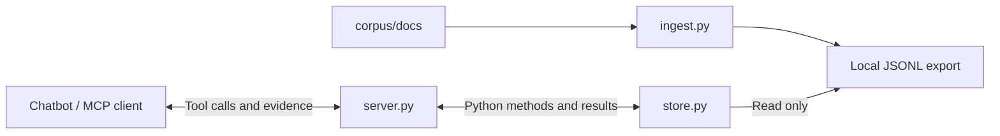

# RAG-Symposium

A small local MCP server that gives a compatible chatbot read-only access to
text ingested on an attendee's computer.

**Current scope:** the MCP connection, a generic record adapter, the workshop
corpus in [corpus/](corpus/README.md), and ingestion that chunks it into the
server's export, three search modes (a naive keyword baseline, BM25, and hybrid
BM25 + embeddings), and `rag-eval` for scoring them. No chatbot or model provider
has been selected; any MCP-capable client can connect.

## Start here

Install Python 3.12 (the package supports 3.11–3.13) and
[uv](https://docs.astral.sh/uv/). From the repo root:

```sh
uv sync --locked
uv run rag-symposium --help
uv run python tests/mcp_smoke.py
uv run python tests/http_smoke.py
```

The last two commands start real MCP servers, check them, and shut them down.
They use temporary artificial records and need no API key, chatbot account,
model download or data in the repo. A `PASS` line means the connection check
succeeded; it does not establish a particular chatbot's answer quality.

Then publish the workshop corpus for the server to read:

```sh
uv run rag-ingest
```

This writes `data/documents.jsonl`, one record per PDF page. See
[Ingestion](#ingestion) for the other chunking modes.

To leave a local HTTP endpoint running:

```sh
uv run python start-local.py
```

Use `http://127.0.0.1:8765/mcp` in a compatible MCP client. Keep the command
running; Ctrl+C stops it. This is a protocol endpoint, not a chat webpage.
Before ingestion, `data_status` should report zero records.

## Repository map

| File | What to learn from it |
| --- | --- |
| [start-local.py](start-local.py) | A short launcher that forwards options to the existing server in HTTP mode |
| [src/rag_symposium/server.py](src/rag_symposium/server.py) | Tool registration, descriptions, command-line options, and the two connection modes |
| [src/rag_symposium/store.py](src/rag_symposium/store.py) | Reading/validating records, keyword search, citations and paginated reads |
| [src/rag_symposium/ingest.py](src/rag_symposium/ingest.py) | Reading corpus documents, chunking them into records, and publishing the export |
| [src/rag_symposium/embeddings.py](src/rag_symposium/embeddings.py) | Loading the small embedding model hybrid search uses |
| [src/rag_symposium/search.py](src/rag_symposium/search.py) | `rag-search`: one query's results in each mode, from the command line |
| [src/rag_symposium/evaluate.py](src/rag_symposium/evaluate.py) | Scoring search modes against questions with known answers |
| [evals/starter.jsonl](evals/starter.jsonl) | 26 starter questions with the publications that answer them |
| [src/rag_symposium/__init__.py](src/rag_symposium/__init__.py) | Marks the Python package; importing it does not start a server |
| [mcp.example.json](mcp.example.json) | An example client configuration for launching the server over stdio |
| [pyproject.toml](pyproject.toml) | Project requirements, packaging, and the `rag-symposium` command entry point |
| [uv.lock](uv.lock) | Generated exact dependency versions and download hashes; let uv manage it |
| [.gitignore](.gitignore) | Keeps installed dependencies, generated files and local ingestion data off Git |
| [.gitattributes](.gitattributes) | Keeps LF line endings on every OS so character offsets match across laptops |
| [corpus/README.md](corpus/README.md) | The workshop documents: 273 K-State crop publications as text, with credit and snapshot details |
| [data/README.md](data/README.md) | Where the ingestion export lives; it is generated locally, never committed |
| [tests/test_store.py](tests/test_store.py) | Fast examples of adapter behavior and invalid inputs |
| [tests/test_ingest.py](tests/test_ingest.py) | Chunking modes, page provenance, safe publishing, and a check that the real corpus ingests |
| [tests/test_server.py](tests/test_server.py) | Which port/origin options are accepted or rejected |
| [tests/test_evaluate.py](tests/test_evaluate.py) | How `rag-eval` counts a hit, a miss and a not-found warning |
| [tests/mcp_smoke.py](tests/mcp_smoke.py) | A small MCP client that starts and calls the real stdio server |
| [tests/http_smoke.py](tests/http_smoke.py) | Real HTTP calls, browser-origin checks, and server cleanup |

`.venv/` is created by uv on your machine and is not source code. Ignore it when
exploring. The lockfile is generated rather than manually commented or edited.
JSON does not allow comments, so the configuration example is explained below.

## How the pieces work together



- **Ingestion** splits the corpus text into records and keeps each one's source,
  pages and dates. It runs once, before the server is used, not on each question.
- **The store** reads the prepared text, finds matching records and retains sources.
- **MCP** describes callable tools and carries requests/results between the client
  and this server. It does not generate answers or create embeddings.
- **The chatbot** chooses when to call tools and writes its answer using the result.
  Its model and account are configured in that chatbot, outside this server.

The same tool functions are available through both connection modes. Changing
transport does not change the records, search logic or citations.

### Trace one question through the code

1. The client connects and discovers tools. In `create_server()`, `@server.tool`
   registers a Python function; its type hints describe inputs and its docstring
   helps the chatbot understand when to call it.
2. The chatbot calls `data_status()`. `RecordStore.status()` reads/validates the
   configured export and reports its availability and record count.
3. The chatbot calls `search_documents(query, limit)`. `RecordStore.search()`
   matches whole words in titles/text and returns IDs, sources and excerpts.
4. The chatbot calls `get_document(document_id, ...)` to read supporting context.
   The ID is looked up inside the export; it is never treated as a file to open.
5. The result returns over MCP. The chatbot can cite the returned `[record-id]`
   and source reference when writing its answer.

A citation label identifies a record; it does not prove a claim is supported.
Tool descriptions and server instructions guide the chatbot, but do not guarantee
that it will call tools or use evidence correctly. Inspect the returned text.

### Suggested reading order

Start with `start-local.py`, then read `create_server()` in `server.py` to see the
three tool wrappers. Follow those wrappers into `store.py`: `records()` →
`search()` → `get()`. Return to `server.main()` to see startup and transport
selection. Finally, read the tests as runnable examples of expected behavior.

## Connection modes

### HTTP: start a local port yourself

```sh
uv run python start-local.py --port 8766 --data /absolute/path/documents.jsonl
```

The helper locates this repo, asks uv to run the installed command, and forwards
its remaining arguments. For the default port, the equivalent command is:

```sh
uv run --locked rag-symposium --transport http
```

If a browser client sends requests directly from a different web origin, allow
that specific origin (scheme, hostname and optional port):

```sh
uv run python start-local.py --allow-origin https://client.example
```

Replace the example with the actual client's origin, without a page path.
The option is repeatable. It enables CORS response headers for that origin and
permits it in the MCP request-origin check. The code comments explain why these
are separate checks. Wildcard origins are not accepted.

This does not add MCP support to arbitrary websites or bypass browser local-network
permissions. A chatbot that makes calls from its provider's cloud servers cannot
reach your computer's localhost. That case needs a separately designed authenticated
tunnel or hosted endpoint. The current listener binds to `127.0.0.1` and has no
user authentication; it is intended only for local use, not public exposure.
See the [MCP HTTP transport specification](https://github.com/modelcontextprotocol/modelcontextprotocol/blob/main/docs/specification/2026-07-28/basic/transports/streamable-http.mdx).

### Stdio: let the chatbot launch the process

In this mode the MCP client launches/stops the server and uses its standard
input/output streams. No port or separate terminal is needed. Stdio is the
`rag-symposium` command's default mode.

Copy the settings from [mcp.example.json](mcp.example.json) into a compatible
client's configuration, replacing every placeholder path:

| Configuration part | Meaning |
| --- | --- |
| `mcpServers` | A common client-config shape; your client may use a different format |
| `rag-symposium` | The connection's display name in that client |
| `command` | Absolute path to uv; find it with `which uv` or Windows `where uv` |
| `run` | Ask uv to run a command in the project's environment |
| `--directory` and the following path | Locate this repo regardless of the client's working directory |
| `--locked` | Use the dependency lockfile; fail rather than silently resolve changed requirements |
| `rag-symposium` in `args` | Run the entry point defined in `pyproject.toml` |
| `--data` and the following path | Select the ingestion export; use an absolute path |

`args` is an array: each option/path is a separate element, including paths with
spaces. Do not paste one shell command into that array. Reconnect after changing
client settings, then confirm the three tools appear.

## Tools and options

| Tool | Inputs | What it returns |
| --- | --- | --- |
| `data_status` | None | Configured file, existence, record count and search mode |
| `search_documents` | `query`; optional `limit` (default 5, maximum 10) | Source-linked excerpts up to 600 characters each, metadata, matching terms, and read offsets |
| `get_document` | `document_id`; optional `offset` and `max_chars` | Source, metadata and a text slice; `next_offset` identifies the next unread character |

`get_document` defaults to 4,000 characters per call, with a maximum of 10,000.
Start at offset 0 to read from the beginning. Follow `next_offset` until it is
`null`, or stop when you have enough context. Offsets count characters, not tokens.

| Launch option | Default / effect |
| --- | --- |
| `--transport stdio` or `--transport http` | Default `stdio`; the helper selects `http` |
| `--search keyword`, `bm25` or `hybrid` | Default `keyword`, or `RAG_SEARCH_MODE`; see [Search modes](#search-modes) |
| `--embed-model NAME_OR_FOLDER` | Hybrid only. Default `minishlab/potion-base-8M`, or `RAG_EMBED_MODEL` |
| `--data PATH` | Overrides `RAG_DATA_PATH`, otherwise uses `data/documents.jsonl` relative to the server's working directory |
| `--port NUMBER` | HTTP port, default 8765 |
| `--allow-origin ORIGIN` | HTTP-only, repeatable; allows a specific browser origin |

The helper and example client config set the working directory to this repo.
If you invoke the installed server from elsewhere, supply an absolute `--data` path.

## Ingestion

`rag-ingest` reads every document in `corpus/docs/`, splits it into records
and publishes `data/documents.jsonl` in one step. A running server sees the new
export on its next tool call.

| Mode | One record per | Record ID | Records from the workshop corpus |
| --- | --- | --- | --- |
| `page` (default) | PDF page | `MF991-p3` | 3,274 |
| `window` | ~1,500-character window, 200 characters shared with the next | `MF991-w7` | 7,128 |
| `document` | Publication | `MF991` | 273 |

```sh
uv run rag-ingest --mode window --size 1000 --overlap 150
uv run rag-ingest --mode document --output /tmp/whole-docs.jsonl
```

Every record's metadata carries `document_id`, `pages`, `chunk_index`,
`published`, `revised`, `topics` and `credit`, so an answer can cite a page and
prefer a newer publication. Blank pages are skipped. Chunking changes what search
can return: a page can split a table from its heading, a window can split a
sentence, and a whole publication buries one paragraph in dozens of pages.

Ingestion validates every record against the data contract below before
publishing, so a bad corpus fails here and the previous export stays in place.

## Data contract

The adapter expects JSONL: one complete JSON object per line. No source-format
or dataset choice is implied. This illustrative shape is not a bundled export:

```json
{"id":"record-id","title":"Descriptive title","text":"Extracted source text.","source":"original-source-reference","metadata":{}}
```

| Field | Required | Meaning |
| --- | --- | --- |
| `id` | Yes | Unique stable ID, 1–200 letters/numbers/underscores/dots/dashes |
| `title` | Yes | Nonempty display title |
| `text` | Yes | Nonempty extracted text |
| `source` | Yes | Nonempty reference to the original, such as a URL or filename |
| `metadata` | No | JSON object of ingestion-supplied attributes, returned by search and reads |

An adapter can emit a record per document or passage. The server treats each as
an addressable record and returns its source string without following it.

A missing export is normal before ingestion. An existing empty file also has
zero records; `data_available` distinguishes those cases. Every call rereads the
file, so a newly published export is visible without restarting the process.
Publish a complete temporary export and rename it over the old file to avoid
readers seeing a half-written update. Malformed JSON, missing fields and duplicate
IDs produce explicit tool errors; there is no last-good-export cache.

The adapter reads small exports into memory; it is not designed for large indexes
or semantic matching. Future retrieval can replace `RecordStore` while keeping the
tool names.

## Search modes

Both modes search the same records and return the same citations. Pick one when
the server starts (`--search bm25`), then reconnect the client.

| Mode | How it ranks | What fools it |
| --- | --- | --- |
| `keyword` (default) | Counts distinct query words in the title and text. Every word counts the same, and ID breaks ties | Common words (*the, for, in*) count as much as *cheatgrass*; a page that cites `MF991` ties with `MF991` itself |
| `bm25` | Rare words count more than common ones, long records don't win by size, title matches get a boost, and records whose publication ID is in the query come first. Simple plurals match (*fungicides* finds *fungicide*) | Different words for the same thing (*cheat* vs *downy brome*), tables, and anything that needs meaning rather than matching words |
| `hybrid` | BM25 and embedding similarity each rank the records; reciprocal rank fusion combines the two lists. Publication IDs still come first | Tables, old documents that match well, and anything the embedding model wasn't trained to understand |

Hybrid mode embeds every record with
[potion-base-8M](https://huggingface.co/minishlab/potion-base-8M) (MIT license),
a ~30 MB static embedding model that runs on a laptop CPU: the whole corpus
embeds in about a second when the server first searches, and again whenever the
export changes. The first run downloads the model from Hugging Face. To work
offline, point `--embed-model` at a downloaded copy of the model folder. Each
hybrid result's `ranks` shows where BM25 and the embeddings placed it, so you can
see which method found it.

`bm25` and `hybrid` results also carry a `score`, an `id_match` flag and each result's
`missing_terms`. The response lists `missing_terms` (meaningful query words no
returned result contains) and `unknown_terms` (words in no record at all), and
its notice says so. That warning only catches missing *words*. A question about
2026 yields still matches the 2026 variety guide, so search can't tell you the
answer isn't there; the agent has to read the text and say so.

To see exactly what the agent would receive for one question, without an agent:

```sh
uv run rag-search "How do I get rid of downy brome in my wheat field?"
uv run rag-search "MF991" --mode keyword --mode bm25
```

## Measure retrieval with rag-eval

```sh
uv run rag-eval
uv run rag-eval --mode bm25 --show all
uv run rag-eval --questions my-questions.jsonl --data /tmp/whole-docs.jsonl
```

`rag-eval` runs each question in `evals/starter.jsonl` through every search mode
against the current export and prints a table. No model is involved:

| Number | Meaning |
| --- | --- |
| hit@1 | Share of questions where the first result came from a right publication |
| hit@5 | Share where a right one was anywhere in the top 5 (change with `-k`) |
| MRR | Average of 1/rank: 1 for first place, 0.5 for second, 0 for a miss |
| warned: no answer | For questions with no answer in the data, how many got a `missing_terms` warning |
| warned: has answer | False alarms: questions the data does answer that got a warning anyway |

Each question line names the publications that answer it:

```json
{"id": "s05", "category": "fact", "question": "What three yield components are used to estimate wheat yield?", "expect": ["MF3044"], "pages": [1]}
```

`pages` is optional; when present, a result must cover one of those pages.
`"all": true` requires every listed publication in the top k, for questions that
need two sources. An empty `expect` list means the data has no answer.

The score measures whether the evidence reached the agent, not whether the
agent's answer was right. Agents also rewrite questions into their own search
queries, so a question that fails here can still succeed in a chat, and the
other way round. Compare modes and chunking (`rag-ingest --mode ...`, then
`rag-eval --data ...`) on the same questions; a change that fixes one question
can break another.

## Verify and explore

```sh
uv run python -m unittest discover -s tests -v
uv run python tests/mcp_smoke.py
uv run python tests/mcp_smoke.py --search bm25
uv run python tests/mcp_smoke.py --search hybrid
uv run python tests/http_smoke.py
```

The unit tests check Python behavior without network connections. The smoke checks
start real servers and act as MCP clients; they verify discovery, tool calls,
empty startup, source references and bounded reads. The HTTP check also verifies
CORS and Host/Origin restrictions. All test data is temporary and cleaned up.

For self-guided exploration:

- Change a tool's docstring in `server.py`, restart/reconnect, and inspect its
  discovered description. In stdio mode, reconnecting restarts the server.
- Change the keyword query in a test to a synonym and observe that keyword search
  may miss it. That is a starting point for the later semantic-retrieval discussion.
- Lower `max_chars` in a smoke check and watch it follow more read offsets.
- Inspect an invalid-export test to see why broken input becomes a visible error.

These are optional local experiments; reset any test expectations you change.
The tests do not run a language model or prove a chatbot's claims are supported.

## Troubleshooting

| Symptom | Where to look |
| --- | --- |
| `uv` not found | Install uv and check the absolute executable path in the client config |
| Zero records | Call `data_status`; check the selected export path and run `uv run rag-ingest` |
| Invalid data on a particular line | Validate that JSONL record against the data contract above |
| No keyword matches | Try words actually present in the title/text; semantic retrieval is not implemented |
| Port already in use | Stop the other listener or choose another `--port` and update the client URL |
| Browser request rejected | Check the exact allowed origin and the browser client's own local-network permissions |
| Client cannot connect from the cloud | A local listener is not publicly reachable; this needs a different connection setup |
| Stdio connection fails | Confirm the command/paths; stdout must contain only MCP messages, with logs on stderr |

The SDK is constrained to its tested v1 API (`mcp<2`); exact versions live in
`uv.lock`. Edit requirements in `pyproject.toml` and regenerate with `uv lock`
when intentionally changing dependencies. See the [v1 SDK documentation](https://py.sdk.modelcontextprotocol.io/v1/).

All tools read local data only. A cloud-backed chatbot may send retrieved text
to its model provider even though the server/data are local. Review that client's
settings when choosing what data to ingest.
