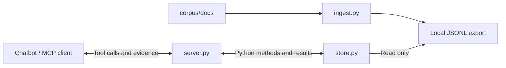

# RAG-Symposium

A small local MCP server that gives a compatible chatbot read-only access to
text ingested on an attendee's computer.

**Current scope:** the MCP connection, a generic record adapter, the workshop
corpus in [corpus/](corpus/README.md) (62 official U.S. AI rules and guidance
documents, 1,847 pages), ingestion that chunks it into the server's export,
three search modes (a naive keyword baseline, BM25, and hybrid BM25 +
embeddings), `rag-eval` for scoring them, and `rag-check` for confirming a
laptop is ready. No chatbot or model provider has been selected; any
MCP-capable client can connect.

The corpus is a teaching snapshot taken 2026-11-10. It is not legal advice and
not a complete or current statement of the law.

## Start here

Install Python 3.12 (the package supports 3.11–3.13) and
[uv](https://docs.astral.sh/uv/). From the repo root:

```sh
uv sync --locked
uv run rag-symposium --help
uv run python tests/mcp_smoke.py
uv run python tests/http_smoke.py
```

The last two commands start real MCP servers, check them, and shut them down.
They use temporary artificial records and need no API key, chatbot account,
model download or data in the repo. A `PASS` line means the connection check
succeeded; it does not establish a particular chatbot's answer quality.

Then publish the workshop corpus for the server to read:

```sh
uv run rag-ingest
```

This writes `data/documents.jsonl`, one record per page, and prints
`Published 1847 records from 62 documents (page mode) to data/documents.jsonl`.
See [Ingestion](#ingestion) for the other chunking modes.

Then check the laptop is ready:

```sh
uv run rag-check
```

`rag-check` works offline and prints one line per step. All four should say
`PASS`, like this:

```text
PASS  export: data/documents.jsonl has 1847 records
PASS  embedding model: /path/to/RAG-Symposium/models/potion-base-8M loads offline (256 dimensions)
PASS  keyword search: 5 results for 'Generative Artificial Intelligence: Overview, Issu', first CRS-IF12426-p1
PASS  hybrid search: 5 results for 'Generative Artificial Intelligence: Overview, Issu', first CRS-R47644-p3
```

A `FAIL` line says what to run next. These commands are the same in macOS
Terminal and Windows PowerShell.

To leave a local HTTP endpoint running:

```sh
uv run python start-local.py
```

Use `http://127.0.0.1:8765/mcp` in a compatible MCP client. Keep the command
running; Ctrl+C stops it. This is a protocol endpoint, not a chat webpage.
Before ingestion, `data_status` should report zero records.

## Workshop setup with OpenCode

The workshop uses [OpenCode](https://opencode.ai), a free, open-source agent
that can run commands, edit files and call this repo's search tools.
[opencode.jsonc](opencode.jsonc) in this folder tells it how to start the
search server, and turns its web tools off so answers come from the documents
here. [WORKSHOP.md](WORKSHOP.md) has every prompt used in the session, in
order, ready to copy.

1. Install the OpenCode desktop app from <https://opencode.ai/desktop>.
2. Download this folder (**Code › Download ZIP**), unzip it and open it in
   OpenCode.
3. Connect a model: type `/connect`, then `/models`. Sign in with ChatGPT
   Plus or Pro (choose **OpenAI**) or GitHub Copilot (the free plan works), or
   paste your own API key. In the workshop, anyone without one of those pastes
   the workshop key (choose **OpenCode**, then the model **GLM-5.3-Flash**).
   OpenCode also has free models that need no account, but their usage limit
   is too low to rely on.
4. Paste: `If uv is not installed on this computer, install it for this user only, following https://docs.astral.sh/uv/ . Then run uv sync --locked, then uv run rag-ingest, then uv run rag-check, and tell me whether every line says PASS.`
5. Start a new session and ask: `What tools do you have, and is the data loaded?`
   It should call `rag_data_status` and report 1,847 records.

The tools are the same whichever model you connect: OpenCode supplies the ones
for reading files and running commands, and this folder supplies the three
`rag_` search tools. Models differ in how well they use them, which is what
the evaluation step measures.

If the answer does not name the three `rag_` tools, OpenCode could not start
the search server, usually because it cannot find `uv`. Ask it: `Find the full
path of the uv program on this computer and put that full path in place of "uv"
in opencode.jsonc.` Then start a new session.

After changing `opencode.jsonc` or `src/rag_symposium/server.py`, start a new
session so the search server restarts with the change. Tested with the OpenCode
command-line version 2.2.7 on Linux and the model GLM-5.3-Flash (free tier);
any other MCP-capable client can use [mcp.example.json](mcp.example.json).

## Repository map

| File | What to learn from it |
| --- | --- |
| [start-local.py](start-local.py) | A short launcher that forwards options to the existing server in HTTP mode |
| [src/rag_symposium/server.py](src/rag_symposium/server.py) | Tool registration, descriptions, command-line options, and the two connection modes |
| [src/rag_symposium/store.py](src/rag_symposium/store.py) | Reading/validating records, the three search modes, ID and alias matching, `document_status`, citations and paginated reads |
| [src/rag_symposium/ingest.py](src/rag_symposium/ingest.py) | Reading corpus documents, chunking them into records, and publishing the export |
| [src/rag_symposium/embeddings.py](src/rag_symposium/embeddings.py) | Loading the small embedding model hybrid search uses |
| [src/rag_symposium/search.py](src/rag_symposium/search.py) | `rag-search`: one query's results in each mode, from the command line |
| [src/rag_symposium/evaluate.py](src/rag_symposium/evaluate.py) | Scoring search modes against questions with known answers |
| [src/rag_symposium/check.py](src/rag_symposium/check.py) | `rag-check`: PASS/FAIL for the export, the offline embedding model and both searches |
| [evals/starter.jsonl](evals/starter.jsonl) | Starter questions with the documents (and pages) that answer them |
| [src/rag_symposium/__init__.py](src/rag_symposium/__init__.py) | Marks the Python package; importing it does not start a server |
| [mcp.example.json](mcp.example.json) | An example client configuration for launching the server over stdio |
| [pyproject.toml](pyproject.toml) | Project requirements, packaging, and the `rag-symposium` command entry point |
| [uv.lock](uv.lock) | Generated exact dependency versions and download hashes; let uv manage it |
| [.gitignore](.gitignore) | Keeps installed dependencies, generated files and local ingestion data off Git |
| [.gitattributes](.gitattributes) | Keeps LF line endings on every OS so character offsets match across laptops |
| [corpus/README.md](corpus/README.md) | The workshop documents: 62 official U.S. AI rules and guidance documents as text, with status, evidence and snapshot details |
| [corpus/sources.jsonl](corpus/sources.jsonl) | The curated source list: one official document per line, with its status evidence |
| [corpus/fetch_sources.py](corpus/fetch_sources.py) | The facilitator script that builds `corpus/docs/` and `corpus/manifest.jsonl` from that list |
| [data/README.md](data/README.md) | Where the ingestion export lives; it is generated locally, never committed |
| [tests/test_store.py](tests/test_store.py) | Fast examples of adapter behavior and invalid inputs |
| [tests/test_ingest.py](tests/test_ingest.py) | Chunking modes, page provenance, safe publishing, and a check that the real corpus ingests |
| [tests/test_server.py](tests/test_server.py) | Which port/origin options are accepted or rejected |
| [tests/test_evaluate.py](tests/test_evaluate.py) | How `rag-eval` counts a hit, a miss, a page miss and a not-found warning |
| [tests/test_check.py](tests/test_check.py) | Which `rag-check` lines pass or fail with a missing export or model |
| [tests/test_search.py](tests/test_search.py) | That `rag-search` prints each result's date and status |
| [tests/mcp_smoke.py](tests/mcp_smoke.py) | A small MCP client that starts and calls the real stdio server |
| [tests/http_smoke.py](tests/http_smoke.py) | Real HTTP calls, browser-origin checks, and server cleanup |

`.venv/` is created by uv on your machine and is not source code. Ignore it when
exploring. The lockfile is generated rather than manually commented or edited.
JSON does not allow comments, so the configuration example is explained below.

## How the pieces work together



- **Ingestion** splits the corpus text into records and keeps each one's source,
  pages and dates. It runs once, before the server is used, not on each question.
- **The store** reads the prepared text, finds matching records and retains sources.
- **MCP** describes callable tools and carries requests/results between the client
  and this server. It does not generate answers or create embeddings.
- **The chatbot** chooses when to call tools and writes its answer using the result.
  Its model and account are configured in that chatbot, outside this server.

The same tool functions are available through both connection modes. Changing
transport does not change the records, search logic or citations.

### Trace one question through the code

1. The client connects and discovers tools. In `create_server()`, `@server.tool`
   registers a Python function; its type hints describe inputs and its docstring
   helps the chatbot understand when to call it.
2. The chatbot calls `data_status()`. `RecordStore.status()` reads/validates the
   configured export and reports its availability and record count.
3. The chatbot calls `search_documents(query, limit)`. `RecordStore.search()`
   matches whole words in titles/text and returns IDs, sources and excerpts.
4. The chatbot calls `get_document(document_id, ...)` to read supporting context.
   The ID is looked up inside the export; it is never treated as a file to open.
5. The result returns over MCP. The chatbot can cite the returned `[record-id]`
   and source reference when writing its answer.

A citation label identifies a record; it does not prove a claim is supported.
Tool descriptions and server instructions guide the chatbot, but do not guarantee
that it will call tools or use evidence correctly. Inspect the returned text.

### Suggested reading order

Start with `start-local.py`, then read `create_server()` in `server.py` to see the
three tool wrappers. Follow those wrappers into `store.py`: `records()` →
`search()` → `get()`. Return to `server.main()` to see startup and transport
selection. Finally, read the tests as runnable examples of expected behavior.

## Connection modes

### HTTP: start a local port yourself

```sh
uv run python start-local.py --port 8766 --data /absolute/path/documents.jsonl
```

The helper locates this repo, asks uv to run the installed command, and forwards
its remaining arguments. For the default port, the equivalent command is:

```sh
uv run --locked rag-symposium --transport http
```

If a browser client sends requests directly from a different web origin, allow
that specific origin (scheme, hostname and optional port):

```sh
uv run python start-local.py --allow-origin https://client.example
```

Replace the example with the actual client's origin, without a page path.
The option is repeatable. It enables CORS response headers for that origin and
permits it in the MCP request-origin check. The code comments explain why these
are separate checks. Wildcard origins are not accepted.

This does not add MCP support to arbitrary websites or bypass browser local-network
permissions. A chatbot that makes calls from its provider's cloud servers cannot
reach your computer's localhost. That case needs a separately designed authenticated
tunnel or hosted endpoint. The current listener binds to `127.0.0.1` and has no
user authentication; it is intended only for local use, not public exposure.
See the [MCP HTTP transport specification](https://github.com/modelcontextprotocol/modelcontextprotocol/blob/main/docs/specification/2026-07-28/basic/transports/streamable-http.mdx).

### Stdio: let the chatbot launch the process

In this mode the MCP client launches/stops the server and uses its standard
input/output streams. No port or separate terminal is needed. Stdio is the
`rag-symposium` command's default mode.

Copy the settings from [mcp.example.json](mcp.example.json) into a compatible
client's configuration, replacing every placeholder path:

| Configuration part | Meaning |
| --- | --- |
| `mcpServers` | A common client-config shape; your client may use a different format |
| `rag-symposium` | The connection's display name in that client |
| `command` | Absolute path to uv; find it with `which uv` or Windows `where uv` |
| `run` | Ask uv to run a command in the project's environment |
| `--directory` and the following path | Locate this repo regardless of the client's working directory |
| `--locked` | Use the dependency lockfile; fail rather than silently resolve changed requirements |
| `rag-symposium` in `args` | Run the entry point defined in `pyproject.toml` |
| `--search` and `bm25` | Pick the search mode; change it to `hybrid` or `keyword` to compare |
| `--data` and the following path | Select the ingestion export; use an absolute path |

`args` is an array: each option/path is a separate element, including paths with
spaces. Do not paste one shell command into that array. Reconnect after changing
client settings, then confirm the three tools appear.

## Tools and options

| Tool | Inputs | What it returns |
| --- | --- | --- |
| `data_status` | None | Configured file, existence, record count and search mode |
| `search_documents` | `query`; optional `limit` (default 5, maximum 10) | Source-linked excerpts up to 600 characters each, `document_status`, metadata, matching terms, and read offsets |
| `get_document` | `document_id`; optional `offset` and `max_chars` | Source, `document_status`, metadata and a text slice; `next_offset` identifies the next unread character |

`document_status` sits next to each result's title and sums up the document's
standing in one line, such as `revoked; published 2023-10-30; replaced by EO-14148`
for Executive Order 14110, or `rescinded; published 2024-03-28; replaced by
OMB-M-25-21` for OMB memo M-24-10. The server's instructions ask the chatbot to
state it when citing and to prefer documents in force. A record with no status
has no `document_status`.

`get_document` defaults to 4,000 characters per call, with a maximum of 10,000.
Start at offset 0 to read from the beginning. Follow `next_offset` until it is
`null`, or stop when you have enough context. Offsets count characters, not tokens.

| Launch option | Default / effect |
| --- | --- |
| `--transport stdio` or `--transport http` | Default `stdio`; the helper selects `http` |
| `--search keyword`, `bm25` or `hybrid` | Default `keyword`, or `RAG_SEARCH_MODE`; see [Search modes](#search-modes) |
| `--embed-model NAME_OR_FOLDER` | Hybrid only. Default: the bundled `models/potion-base-8M`, or `RAG_EMBED_MODEL` |
| `--data PATH` | Overrides `RAG_DATA_PATH`, otherwise uses `data/documents.jsonl` relative to the server's working directory |
| `--port NUMBER` | HTTP port, default 8765 |
| `--allow-origin ORIGIN` | HTTP-only, repeatable; allows a specific browser origin |

The helper and example client config set the working directory to this repo.
If you invoke the installed server from elsewhere, supply an absolute `--data` path.

## Ingestion

`rag-ingest` reads every document in `corpus/docs/`, splits it into records
and publishes `data/documents.jsonl` in one step. A running server sees the new
export on its next tool call.

| Mode | One record per | Record ID | Records from the workshop corpus |
| --- | --- | --- | --- |
| `page` (default) | PDF page, or numbered ~3,000-character section of a web page | `OMB-M-24-10-p3` | 1,847 |
| `window` | ~1,500-character window, 200 characters shared with the next | `OMB-M-24-10-w7` | 4,214 |
| `document` | Document | `OMB-M-24-10` | 62 |

```sh
uv run rag-ingest --mode window --size 1000 --overlap 150
uv run rag-ingest --mode document --output data/whole-docs.jsonl
```

Every record's metadata carries `document_id`, `pages`, `chunk_index`,
`aliases`, `issuer`, `published`, `revised`, `status`, `status_note`,
`replaces`, `replaced_by`, `topics` and `credit`, copied from its document's
header (see [corpus/README.md](corpus/README.md)). So an answer can cite a page,
name who issued the document, and say that it was revoked and what replaced it.
Blank pages are skipped. Chunking changes what search can return: a page can
split a table from its heading, a window can split a sentence, and a whole
document buries one paragraph in dozens of pages.

Ingestion validates every record against the data contract below before
publishing, so a bad corpus fails here and the previous export stays in place.

## Data contract

The adapter expects JSONL: one complete JSON object per line. No source-format
or dataset choice is implied. This illustrative shape is not a bundled export:

```json
{"id":"record-id","title":"Descriptive title","text":"Extracted source text.","source":"original-source-reference","metadata":{}}
```

| Field | Required | Meaning |
| --- | --- | --- |
| `id` | Yes | Unique stable ID, 1–200 letters/numbers/underscores/dots/dashes |
| `title` | Yes | Nonempty display title |
| `text` | Yes | Nonempty extracted text |
| `source` | Yes | Nonempty reference to the original, such as a URL or filename |
| `metadata` | No | JSON object of ingestion-supplied attributes, returned by search and reads |

An adapter can emit a record per document or passage. The server treats each as
an addressable record and returns its source string without following it.

A missing export is normal before ingestion. An existing empty file also has
zero records; `data_available` distinguishes those cases. Every call rereads the
file, so a newly published export is visible without restarting the process.
Publish a complete temporary export and rename it over the old file to avoid
readers seeing a half-written update. Malformed JSON, missing fields and duplicate
IDs produce explicit tool errors; there is no last-good-export cache.

The adapter reads small exports into memory; it is not designed for large indexes.
Future retrieval can replace `RecordStore` while keeping the
tool names.

## Search modes

All three modes search the same records and return the same citations. Pick one when
the server starts (`--search bm25`), then reconnect the client.

| Mode | How it ranks | What fools it |
| --- | --- | --- |
| `keyword` (default) | Counts distinct query words in the title and text. Every word counts the same, and ID breaks ties. It deliberately does not recognize document IDs | Common words (*the, for, in*) count as much as *deepfake*; pages of a report that cites `M-24-10` outrank the memo itself |
| `bm25` | Rare words count more than common ones, long records don't win by size, title matches get a boost, and records whose document ID or alias is in the query come first. Simple plurals match (*deepfakes* finds *deepfake*) | Different words for the same thing (*AI* vs *SI* or *Super Intelligence*), tables, and anything that needs meaning rather than matching words |
| `hybrid` | BM25 and embedding similarity each rank the records; reciprocal rank fusion combines the two lists. Document IDs and aliases still come first | Tables, old documents that match well (a revoked order reads like a current one), and anything the embedding model wasn't trained to understand |

In `bm25` and `hybrid`, an ID or alias matches however it is written: `M-24-10`,
`m 24 10`, `OMB M-24-10`, `EO 14110` and `Executive Order 14110` all put that
document's own pages first. Case, spaces and dashes are ignored, but the match
must be whole words, so `EO 141105` is not `EO 14110`. Each document's aliases
are listed in its header.

Words changed in the newest documents. Executive Order 14434 (September 29,
2026) tells agencies to write "Super Intelligence" or "SI" instead of
"Artificial Intelligence" or "AI", so the Department of Education's November
2026 proposal (`ED-FR-2026-22615`) talks about *SI literacy* while its April
2026 final rule (`ED-FR-2026-07087`) defines *AI literacy*. A word search for
one term can miss documents that use only the other.

Hybrid mode embeds every record with
[potion-base-8M](https://huggingface.co/minishlab/potion-base-8M) (MIT license),
a ~30 MB static embedding model that runs on a laptop CPU: the whole corpus
embeds in about a second when the server first searches, and again whenever the
export changes. A copy of the model ships in [models/](models/potion-base-8M), so
hybrid search needs no download; `--embed-model` can name another local folder
or a Hugging Face model to compare. Each
hybrid result's `ranks` shows where BM25 and the embeddings placed it, so you can
see which method found it.

`bm25` and `hybrid` results also carry a `score`, an `id_match` flag and each result's
`missing_terms`. The response lists `missing_terms` (meaningful query words no
returned result contains) and `unknown_terms` (words in no record at all), and
its notice says so. That warning only catches missing *words*. "How many
students used AI tools in 2026?" gets no warning, because the 2026 Department of
Education grant priorities contain every word, yet they are not a count of
students. Search
can't tell you the answer isn't there; the agent has to read the text and say so.
It also has to read `document_status`: "What must agencies do under OMB M-24-10
by December 2026?" returns the memo's own pages, and every one is marked
`rescinded`.

To see exactly what the agent would receive for one question, without an agent:

```sh
uv run rag-search "What is the Department of Education's current definition of AI literacy?"
uv run rag-search "M-24-10" --mode keyword --mode bm25
```

The first shows the in-force April 2026 rule and the November 2026 draft side by
side; change *AI* to *SI* and `bm25` returns only the draft. The second shows
keyword search ranking pages of a CRS report that cites the memo, while `bm25`
puts the memo's own pages first:

```text
keyword
  1. CRS-R48555-p11      2025-06-04 unknown    Regulating Artificial Intelligence: U.S. and Internation
  ...

bm25
  1. OMB-M-24-10-p24 2024-03-28 rescinded Advancing Governance, Innovation, and Risk Management fo
  2. OMB-M-24-10-p1  2024-03-28 rescinded Advancing Governance, Innovation, and Risk Management fo
  ...
```

## Measure retrieval with rag-eval

```sh
uv run rag-eval
uv run rag-eval --mode bm25 --show all
uv run rag-eval --questions my-questions.jsonl --data data/whole-docs.jsonl
```

`rag-eval` runs each question in `evals/starter.jsonl` through every search mode
against the current export and prints a table. No model is involved:

| Number | Meaning |
| --- | --- |
| document hit@1 | Share of questions where the first result came from a right document |
| document hit@5 | Share where a right one was anywhere in the top 5 (change with `-k`) |
| MRR | Average of 1/rank: 1 for first place, 0.5 for second, 0 for a miss |
| page hit@1, page hit@5 | The same, counting only questions that name pages, and the result must also cover one of those pages |
| warned: no answer | For questions with no answer in the data, how many got a `missing_terms` warning |
| warned: has answer | False alarms: questions the data does answer that got a warning anyway |

Document-level scores ask whether search found the right document; page-level
scores ask whether it found the right page of it. The right memo on the wrong
page is a document hit and a page miss.

With the starter questions and the default page-mode export:

| Mode | document hit@1 | document hit@5 | MRR | page hit@1 | page hit@5 | warned: no answer | warned: has answer |
| --- | --- | --- | --- | --- | --- | --- | --- |
| `keyword` | 14% | 50% | 0.28 | 5% | 27% | 0 of 4 | 0 of 22 |
| `bm25` | 55% | 77% | 0.62 | 32% | 50% | 2 of 4 | 12 of 22 |
| `hybrid` | 59% | 77% | 0.65 | 41% | 50% | 4 of 4 | 15 of 22 |

Each question line names the documents that answer it. For example:

```json
{"id": "x01", "category": "fact", "question": "How does the Department of Education define AI literacy?", "expect": ["ED-FR-2026-07087"], "pages": [6]}
```

`pages` is optional; when present, the question also counts toward the page
scores. `"all": true` requires every listed document in the top k, for questions
that need two sources. An empty `expect` list means the data has no answer.

The score measures whether the evidence reached the agent, not whether the
agent's answer was right. Agents also rewrite questions into their own search
queries, so a question that fails here can still succeed in a chat, and the
other way round. Compare modes and chunking (`rag-ingest --mode ...`, then
`rag-eval --data ...`) on the same questions; a change that fixes one question
can break another.

## Using your own documents

Put one UTF-8 text file per document in a folder, named `<ID>.md`. Each file
starts with a header between `---` lines, one `key: JSON value` per line, then
the text. `<!-- page N -->` lines mark where each page starts; without them the
whole file is page 1. Only `id`, `title` and `source_url` are required; the
other fields in [corpus/README.md](corpus/README.md#document-header) default
to empty.

```text
---
id: "POLICY-1"
aliases: ["Policy 1"]
title: "Department AI use policy"
issuer: "Your department"
published: "2026-08-01"
status: "in force"
source_url: "https://example.edu/policy-1"
---

<!-- page 1 -->
Text of the first page.
```

Then ingest that folder into its own export, write a few questions with known
answers (one JSON line each, as in [rag-eval](#measure-retrieval-with-rag-eval)),
and score them:

```sh
uv run rag-ingest --corpus my-docs --output my-docs.jsonl
uv run rag-eval --data my-docs.jsonl --questions my-questions.jsonl
```

Start the server with `--data` pointing at the same export (use an absolute path).
To replace the workshop corpus instead, put the files in `corpus/docs/`, run
`uv run rag-ingest`, then `uv run rag-eval --questions my-questions.jsonl`.

## Verify and explore

```sh
uv run rag-check
uv run python -m unittest discover -s tests -v
uv run python tests/mcp_smoke.py
uv run python tests/mcp_smoke.py --search bm25
uv run python tests/mcp_smoke.py --search hybrid
uv run python tests/http_smoke.py
```

`rag-check` confirms this laptop's export, offline model and searches. The unit
tests check Python behavior without network connections. The smoke checks
start real servers and act as MCP clients; they verify discovery, tool calls,
empty startup, source references and bounded reads. The HTTP check also verifies
CORS and Host/Origin restrictions. All test data is temporary and cleaned up.

For self-guided exploration:

- Change a tool's docstring in `server.py`, restart/reconnect, and inspect its
  discovered description. In stdio mode, reconnecting restarts the server.
- Change the keyword query in a test to a synonym and observe that keyword search
  may miss it. That is a starting point for the later semantic-retrieval discussion.
- Lower `max_chars` in a smoke check and watch it follow more read offsets.
- Inspect an invalid-export test to see why broken input becomes a visible error.

These are optional local experiments; reset any test expectations you change.
The tests do not run a language model or prove a chatbot's claims are supported.

## Troubleshooting

| Symptom | Where to look |
| --- | --- |
| `uv` not found | Install uv and check the absolute executable path in the client config |
| Zero records | Call `data_status`; check the selected export path and run `uv run rag-ingest` |
| `rag-check` fails on the embedding model | While online, run `uv run rag-search "test" --mode hybrid` once, then rerun `uv run rag-check` |
| Invalid data on a particular line | Validate that JSONL record against the data contract above |
| No keyword matches | Try words actually present in the title/text (newer documents say *SI*, older ones *AI*), or start the server with `--search hybrid` |
| Port already in use | Stop the other listener or choose another `--port` and update the client URL |
| Browser request rejected | Check the exact allowed origin and the browser client's own local-network permissions |
| Client cannot connect from the cloud | A local listener is not publicly reachable; this needs a different connection setup |
| Stdio connection fails | Confirm the command/paths; stdout must contain only MCP messages, with logs on stderr |

The SDK is constrained to its tested v1 API (`mcp<2`); exact versions live in
`uv.lock`. Edit requirements in `pyproject.toml` and regenerate with `uv lock`
when intentionally changing dependencies. See the [v1 SDK documentation](https://py.sdk.modelcontextprotocol.io/v1/).

All tools read local data only. A cloud-backed chatbot may send retrieved text
to its model provider even though the server/data are local. Review that client's
settings when choosing what data to ingest.
